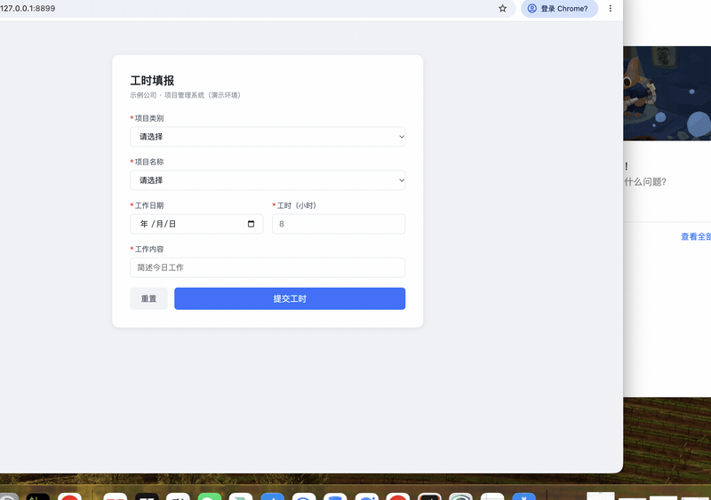

# dsh-ax-computer-use





[English](README.md) | [中文](README.zh.md)

**面向 [DeepSeek Harness](https://github.com/deepseek-ai/deepseek-harness) 的通用 AX-first 电脑操作插件（macOS / Windows / Linux 三平台）** —— 让智能体直接读系统无障碍树（macOS AX / Windows UIA / Linux AT-SPI2）来"看"屏幕，以**批量、机器验证**的方式执行动作，只在真正需要像素时才退回截图。覆盖**所有类型的桌面应用**，不限于某一类：

| 应用类型 | 例子 | 有效通道 | 实测 |
|---|---|---|---|
| 原生 AppKit | 文本编辑、Finder、多数系统应用 | 完整 AX：读树、AXSetValue 写回、菜单遍历 | 端到端 ✅ |
| Chromium 浏览器 | Chrome、Edge、多窗口多显示器 | 渲染器 AX 树 + HID 级点击 | 双屏 bilibili 选集面板 ✅ |
| Electron / CEF 内嵌 | 飞书/Lark、Slack、VS Code webview | 强制渲染器 AX 重启 + 视觉坐标 + 内联 verify | 5 字段企业表单（antd 下拉）✅ |
| 自绘 UI（AX 树为空） | 微信、游戏启动器、kiosk 应用 | 截图→坐标→HID 点击 + CGEvent 中文键入 | IM 发消息 4 轮 ✅ |

六个工具：`ax_windows` / `ax_tree` / `ax_act` / `ax_read` / `ax_shot` / `ax_relaunch`。各类型的任务配方见 [skills/](skills/)。

<p align="center">
  <a href="assets/bilibili-episode-panel.jpg"></a>
</p>
<p align="center"><sub>网页内容按文本读取（按钮、链接、播放器控件），在多窗口多显示器的 Chrome 上用 HID 级点击驱动——整个循环不猜任何像素。</sub></p>

## 为什么做这个

纯视觉的 computer use 又慢又盲，循环是这样的：

> 截图 → 模型看像素 → 猜坐标 → 点击 → 再截图确认 → 再猜……

每一步都要一张全分辨率图片加一次模型往返；填一张表单走上二十多个来回很正常。点错了没有任何东西告诉你——模型只能靠*下一张*截图去发现，前提是它记得检查。

本插件把循环反过来：

| | 纯视觉点击 | dsh-ax-computer-use |
|---|---|---|
| 读屏 | 每步全截图 + 视觉模型 | AX 树文本（单窗口约 1 KB，读取约 100 ms） |
| 操作 | 每回合一次合成点击 | **批量 JSON 动作**——填表 + 提交 + 验证一次调用完成 |
| 知道发生了什么 | 祈祷下一张截图能看出来 | 每个动作返回 `confirmed` / `unverified` / `suspected_noop` / `errors`，附焦点 before→after 和窗口清单 diff |
| 定位控件 | 重新截图、重新找、重新猜 | 按**文字**定位（`{"op":"press","text":"提交","role":"AXButton"}`），免疫动态 DOM 重排 |
| 截图 | 原图直出 | `screencapture` → JPEG q80 @1280px：2.1 MB → 约 95 KB（**省 95% token**） |

真实任务实测：某个 CEF 架构企业应用里的填表流程，纯视觉要点 20–30 分钟，端到端（打开表单 → 逐字段下拉选择 → 每步验证 → 关闭）**含截图验证约 3 分钟**——模型往返大约减少 **10 倍**。

## 验证是来真的

`ax_act` 接收 JSON 动作数组（`press`、`set`、`type`、`key`、`click`、`menu`、`focus`、`read`、`select`、`scroll`、`wait`），逐动作返回状态行加汇总。验证是真验证，不是"返回码盖章"：

- `set` / `type` —— 走 `AXSetValue` 写入后**读回值核对**；追加写入对准焦点元素当前值，写了一半一眼可见。
- `press` —— 查元素 `AXActions` 列表，依次降级勾选框翻转；对网页元素专门识别"AXPress 返回成功但啥也没发生"的陷阱（渲染器无障碍半激活态），**如实报 `unverified` 而不是假装成功**；可选 HID 级点击兜底。
- `click` —— HID 级全局点击，带**前台应用守卫**：目标应用不在前台时先激活，仍不对就追加 `WARN_FRONT`，避免点击落到错误窗口上。可选**内联 verify 守卫**（`"verify":{"path":…,"contains":"…"}`）：点击后自动读回目标值，不匹配**立即中止剩余批量动作**——下拉选错时链条当场停下，而不是污染后面的所有字段。点击落在网页内容上时自动切到 HID（`click-autohid`），并**自动取证**：窗口清单 diff / 焦点变化 / 点击区域缩略图差异，状态行会给出 `confirmed (…)` 或 `unverified (no observable change — …)`，不再一律 unverified。`ax_shot` 返回 `img=W×H scale=S origin=X,Y`，`{"op":"click","shot":[px,py]}` 直接用截图像素坐标，引擎替你换算到屏幕。
- `menu` —— 下钻原生菜单层级（包括"菜单以 AXChildren 暴露"的怪癖），叶子节点回退为报告快捷键。
- 每批动作汇报 `FOCUS before→after`、`FOCUSPATH`、**窗口清单 diff**（`WINDOWS`——新增/关闭/改标题），副作用立即浮出水面。

`ax_tree` 输出紧凑的、可交互元素优先的树，带稳定的 `path:Role` 引用、中英文标签、焦点标记；默认深度 18（Electron 网页内容在 10～14 层），可 AXPress 但无标题的节点也会保留并给出 `@cx,cy`，输入框带 `ph=占位符`；`--text` 不受深度限制、跨全部窗口搜索并打印命中行及其祖先；`--root REF` 只展开某个子树。Chromium 的惰性树会先预热再读，侧栏/弹窗不再时有时无。`ax_shot` 单窗口截图（多显示器安全），走 DSH 附件管线返回。`ax_relaunch` **带参数重启应用且不掉登录态**。

## 原生、网页、Electron —— 一套工具全覆盖

- **原生应用（三平台）**：完整无障碍树读写——macOS 用 AX、Windows 用 UI Automation、Linux 用 AT-SPI2。实测 `AXSetValue` 类写入 8 ms 内带读回确认。菜单、工具栏勾选框、文字插入全部验证通过。
- **Chrome / Chromium 浏览器**：渲染器 AX 树原生暴露，网页内容按文本读。AX 派发不了的动作降级走 **HID 级硬件事件**——多窗口多显示器下实测点开 bilibili 选集面板。
- **隐藏 AX 树的 Electron / CEF 应用**（Lark 及大量 Electron 架构应用）：`ax_relaunch --app Lark --args "--force-renderer-accessibility"` 带参数重启——**登录不掉**——整张网页界面变得可读可操作。这是纯视觉工具完全做不到的场景。

## 安装

```sh
dsh plugin add github:OneOfJuly/dsh-ax-computer-use
```

或等目录收录后在插件市场搜 **dsh-ax-computer-use**（Plugins → Discover）。

环境要求：

- macOS：Apple Silicon 预编译 `bin/axc`（arm64）；Intel Mac 用 `swiftc -O` 从 `src/axc.swift` 自行编译替换
- Windows：系统自带 PowerShell 5.1+ 即可，无需安装——`engines/axc.ps1`（UIA + SendInput + WinRT OCR）
- Linux（X11）：需 `python3-pyatspi`、`python3-xlib`、`xdotool`、`wmctrl`、`tesseract-ocr tesseract-ocr-chi-sim`、`scrot`——`engines/axc.py`（AT-SPI2 + XTest）
- DSH ≥ 0.2.1（实测 0.2.2-rc.5）。
- macOS：给 DSH 宿主应用授予**辅助功能** + **屏幕录制**（系统设置 → 隐私与安全性），引擎作为子进程继承权限
- Windows：无需特殊配置（UIA 不受限；OCR 需系统语言包）
- Linux：开启无障碍支持（GNOME：设置 → 辅助功能，或 `gsettings set org.gnome.desktop.interface toolkit-accessibility true`）

## 架构

每个操作系统一个无状态引擎（macOS：Swift 二进制 `bin/axc`；Windows：PowerShell `engines/axc.ps1`；Linux：Python `engines/axc.py`——同一 CLI 契约，详见 [ARCHITECTURE.md](ARCHITECTURE.md)）；`index.js` 是六个 DSH 工具的薄映射。每次工具调用启动一个短命进程：列窗口、倒树、跑动作批、截图、重启应用。没有持久状态，没有可崩的东西，没有需要清理的东西。

安全姿态：HID 点击会动真实鼠标，受前台应用守卫保护；键盘事件按进程投递（不抢全局焦点）；二进制**不联网、不留日志**；截图只经 DSH 自身附件管线流转。

## 从源码构建

```sh
swiftc -O -module-cache-path /tmp/axc-cache src/axc.swift -o bin/axc
```

需要 Xcode 工具链（`swiftc`）。module cache 路径必须可写，默认位置常常不可写。

## 相关项目

- [dsh-mac-computer-use](https://github.com/OrderG-X/dsh-mac-computer-use) —— 官方视觉优先插件；本项目最初就是为网页类工作流做的提速替代。
- [dsh-operator](https://github.com/yffo/dsh-operator) —— 另一个带 CDP 浏览器自动化的社区 computer-use 套件。

## 致谢

- [agent-desktop](https://github.com/vercel-labs/agent-desktop)（Apache-2.0）——渲染器无障碍激活技术（设置 `AXManualAccessibility` 后轮询读回）与 STALE-REF / disposition 上报语义借鉴自其设计，已在源码中注明（见 [ARCHITECTURE.md](ARCHITECTURE.md)）。未复制任何代码，本项目为独立实现。

## 许可

MIT
